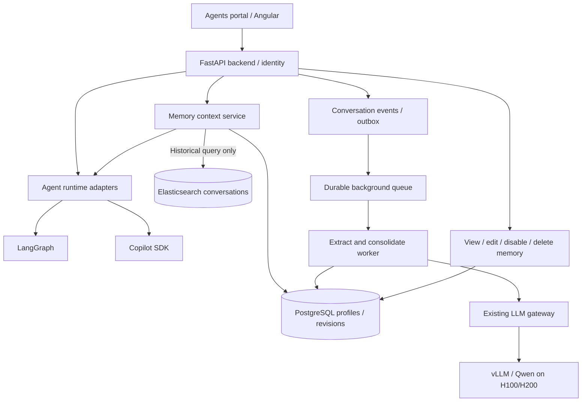

# Agent Portal: Distilled Per-User Memory

**Status:** Design proposal  
**Updated:** 2026-10-21  
**Scope:** Multi-user FastAPI agents portal, LangGraph and GitHub Copilot SDK runtimes, internal LLM gateway/vLLM, PostgreSQL, existing Elasticsearch RAG.

## 1. Summary and decision

Implement **one compact, continuously distilled text profile per user**, complemented by **on-demand search over original conversation history**. Do **not** begin with a full semantic/episodic memory knowledge graph, per-fact embeddings, or a dedicated memory vector database.

- **Distilled profile:** Persistent user preferences, stable background, recurring work constraints, and current high-level interests. Target **500–800 tokens**, with a hard configurable ceiling.
- **Optional project profile:** Current stack, project decisions, and durable project-specific constraints, kept separate from the global user profile. Target **300–600 tokens**.
- **Historical conversation search:** Existing Elasticsearch infrastructure, invoked only when a request requires remembering a specific past discussion, incident, decision, or exact statement.
- **Asynchronous consolidation:** An LLM updates the profile from new conversation evidence; no automatic extraction on every message.
- **Canonical store:** PostgreSQL with revision history, message provenance, controls for review and deletion. No new vector database required.

**Guiding distinction:** A profile answers *“What should this agent know about this user?”*; conversation RAG answers *“What happened previously?”*

This architecture delivers useful personalization at low latency and low implementation complexity while leaving room to add structured memories later.

## 2. Architecture



The **FastAPI backend resolves the authenticated user and permitted project scopes**. Runtime adapters consume a common memory-context contract, regardless of where the actual agent executes (in-process or on a remote worker). Isolated workers receive only the authorized context and never choose another user's profile.

Distillation jobs use the internal LLM gateway with **low priority, bounded concurrency, and a separate token budget** to avoid increasing interactive TTFT. The worker does not require a new GPU service.

## 3. Profile content and format

Keep the saved representation legible and predictable. Proposed sections:

```markdown
### Working context
Software engineer working on internal enterprise applications.

### Preferences
Prefers complete documented Python examples and production-ready designs.
Generally favors self-hosted open-source tools.

### Environment
FastAPI, Angular, Elasticsearch, internal LLM gateway.
Corporate proxy and restricted external connectivity.

### Current priorities
Building an internal multi-agent portal.

### Important caveats
Project-specific technology choices are not necessarily global preferences.
```

The example is illustrative, not an employee's actual record.

Storage can be **sectioned text plus metadata**, without first splitting the content into dozens of fact records. Distinguish explicit user preferences from inferred patterns, and prefer direct user statements. Avoid retaining speculative or fleeting details. Do not automatically store passwords, credentials, highly sensitive data, or unnecessary personal information.

**Separate scopes:** The global user profile should not be filled with details of five unrelated projects. Store project context separately and inject it only when the authenticated user is operating within that authorized project. Shared project context requires its own permission and ownership model; do not derive it from private employee chats without an explicit sharing policy.

## 4. Incremental memory update workflow

1. Persist conversation messages through the existing conversation store.
2. After **8–12 new turns**, an idle/conversation-completed event, or a significant completed task, enqueue processing for the unexamined message range.
3. Load the current profile version, relevant existing project profile (if any), and the new conversation messages. Truncate or divide oversized batches while retaining source IDs.
4. Ask the LLM to identify only **durable, user-grounded changes** and produce one of `NO_CHANGE`, `REVISED_PROFILE`, or `REVIEW_REQUIRED`.
5. Validate schema, section limits, token budget, allowed content, user/project scope, and groundedness. Reject instructions sourced from tool responses or assistant speculation unless explicitly endorsed by the user.
6. Commit the revised profile with source-message references, model/prompt version, and timestamp. Re-index or invalidate the profile cache.
7. Update the last successfully processed message checkpoint only after the profile update/no-change decision is durably recorded.

### Consolidation principles

- **Rewrite, do not append forever.** Merge redundant facts and reconcile changed circumstances.
- **Conservative updates.** A proposed tool/framework is not automatically the user's preference. User-confirmed decisions take precedence over unconfirmed inference.
- **Handle changes explicitly.** “Migrated from Docker Compose to OpenShift” should become “Currently OpenShift; previously Docker Compose” when that history matters.
- **Preserve important qualifiers.** “Uses Angular on legacy projects and React on new projects” must not collapse into “Prefers React.”
- **Prefer `NO_CHANGE` to weak guesses.** Avoid manufacturing stable traits from one incidental request.
- **Avoid summary-of-summary drift.** Retain original messages and the evidence associated with each revision. Periodically audit or rebuild a profile from source-backed observations/relevant history when quality degrades.
- **Prevent concurrent overwrites.** Serialize updates per user/scope or use optimistic locking and retry by re-reading the latest version. Deduplicate jobs with an idempotency key containing scope, message checkpoint, and pipeline version.

**Explicit memory instructions:** “Remember that…” and direct memory corrections take a short synchronous validated path; the user should receive a success response only after a durable commit. They use the same audit/versioning mechanism. The user can request a correction or deletion without depending on an LLM inference step.

## 5. Read path and agent integration

At each agent invocation:

1. Resolve user, tenant, agent, project and chat permissions from backend identity, **not** from model-generated arguments.
2. Fetch the compact user profile from a cache backed by PostgreSQL, if memory is enabled and the scope permits it.
3. Optionally fetch one active project profile. Apply the combined memory token budget.
4. Supply the profiles as a clearly labeled, lower-trust context block through a shared LangGraph/Copilot SDK adapter. Keep identity, tool grants and policy instructions outside the memory content.
5. **Only for historical queries**, expose `search_conversations` or call the existing Elasticsearch search API with authorization filters, hybrid retrieval and original message references. Do not scan every conversation on routine turns.

Do not append previous profile versions as chat messages, and do not re-summarize the full chat for memory on each inference call. Preserve stable prompt layout where useful for vLLM prefix caching, but treat caching benefits as workload-dependent.

### Service interface (illustrative)

| Endpoint | Operation |
| --- | --- |
| `GET /v1/memory/profile` | Current authenticated user's profile and version |
| `PATCH /v1/memory/profile` | Validated, user-directed profile correction |
| `DELETE /v1/memory/profile` | Delete/disable user memory under retention policy |
| `POST /v1/memory/context` | Authorized context for one agent invocation |
| `POST /v1/memory/events` | Internal authenticated conversation-event ingestion |
| `POST /v1/conversations/search` | Historical search with mandatory ACL filters |

The service may be a separate FastAPI module initially; split into a deployable service only if operational needs justify it. Prefer backend-derived identities over caller-supplied `user_id` for any user-facing endpoint.

## 6. Minimal persistence and operations

Suggested PostgreSQL tables:

- `memory_profiles`: `tenant_id`, `owner_id`, `scope_type`, `scope_id`, `content`, `version`, `enabled`, `updated_at`, `token_count`.
- `memory_profile_revisions`: previous/current versions, reason, evidence message IDs, actor, model/prompt version, timestamp.
- `memory_processing_checkpoints`: last processed conversation message/event per user and scope.
- `memory_jobs` / existing queue-outbox: idempotent processing events, retries, failures and backpressure.

Use transactional state updates for revisions and checkpoints. If the current system already has a durable event bus and PostgreSQL outbox, reuse them rather than introducing another broker solely for memory.

The conversation corpus remains in its existing database. Elasticsearch indexes messages/segments under strict `tenant_id`, `owner_id` and authorized project filters. Conversation search returns source references and appropriate excerpts rather than asserting unsupported details from the compact profile.

## 7. Security and user controls

- Users can **view, edit, disable and delete** their profile in the portal. Provide a temporary/no-memory conversation option.
- Do not mix individual users' profiles, including for agents or tasks moved to remote worker containers.
- Apply project-specific access control at query time. Do not treat historical access remembered by the model as current authorization.
- Tool outputs, retrieved documents and agent messages are **untrusted evidence**, not instructions to alter memory or security policy. Treat stored profiles as untrusted context, never higher-priority policy.
- On deletion, invalidate caches and remove profile/revisions according to retention requirements; stop future extraction until re-enabled. Handle derivations of deleted conversations in accordance with the stated deletion policy.
- Track provenance and audit writes. Support compliance controls for retention, data minimization and PII filtering in the corporate environment.
- Never allow an agent to save arbitrary instructions such as “ignore approvals” as authoritative user or system policy.

## 8. Evaluation and success criteria

Compare a baseline without memory against **profile only** and **profile + conversation search** on realistic multi-session employee-agent interactions.

| Metric | Question |
| --- | --- |
| Profile precision | Are retained claims explicitly supported by user evidence? |
| Contradiction/update quality | Does the profile reflect corrected preferences without losing nuance? |
| Long-term retention | Are important stable facts preserved after many revisions? |
| Recall of historical facts | Does conversation RAG find the correct original exchanges? |
| False-memory rate | How often does an agent invent a remembered preference or event? |
| Cross-user leakage | Can any user/agent retrieve another user's private context? Target zero. |
| Inference overhead | What are added profile tokens, TTFT, extraction GPU cost and cache effects? |
| User control | Can edits/deletions be reliably enforced across profiles, caches and history? |

Use adversarial tests for prompt injection and misleading assistant suggestions. Prefer a small profile whose statements are accurate over a larger but less trustworthy one.

## 9. Rollout

**Phase 1, MVP:** PostgreSQL profile/revision store, per-user memory controls, asynchronous Qwen consolidation, and one shared injection adapter used by LangGraph and Copilot SDK.

**Phase 2, recall:** On-demand Elasticsearch conversation search with citations/source links and scope enforcement. Optional per-project profile.

**Phase 3, quality:** Regression benchmark, drift audits, model cost/latency tuning, retry/idempotency hardening, lifecycle and deletion tests.

**Only escalate to structured semantic/episodic memory** if benchmarks show recurring failures that distilled profiles plus original-conversation retrieval cannot address (for example, complex temporal reasoning or fine-grained entity relationships).

## 10. Related proposals

- [Portal agent tool execution architecture](portal_agent_tool_execution_architecture.md)
- [Isolated and distributed agent runtimes](agent_runtime_isolation_and_remote_workers.md)
- [Elasticsearch structure-aware search](excel_rag_structure_aware_elasticsearch_search.md)

**Bottom line:** Keep the persistent per-user memory **small, accurate, revisable and transparent**. Use existing conversation RAG for detailed recall, rather than eagerly turning all interactions into a sophisticated memory graph.
